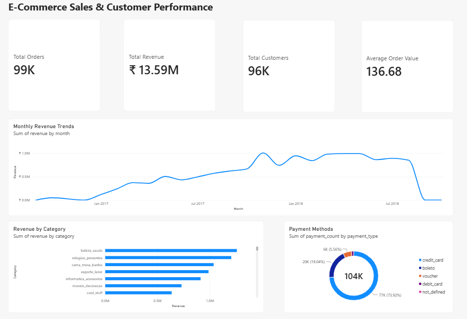
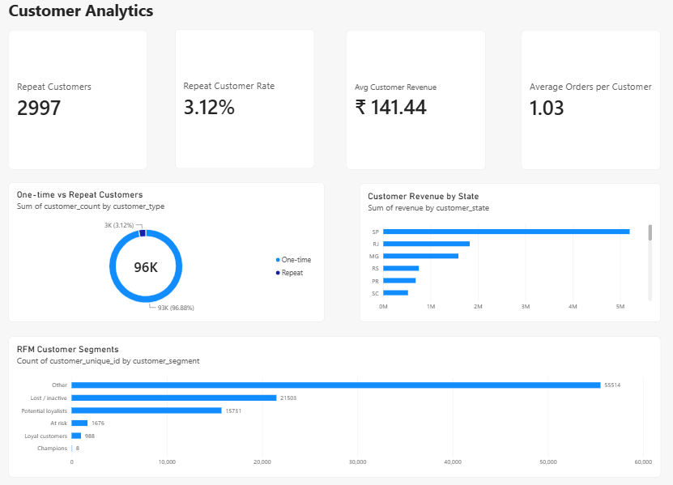
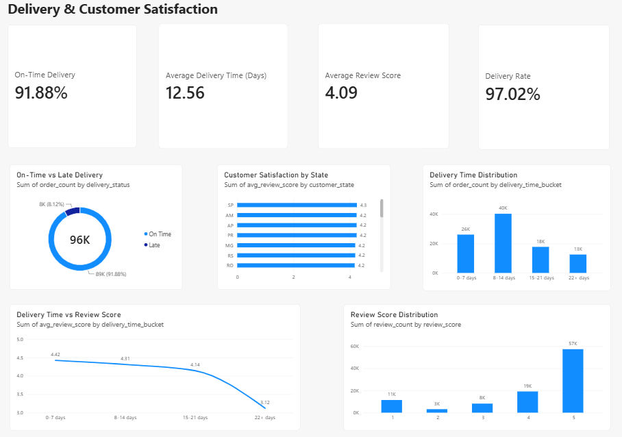

# E-Commerce Sales & Customer Performance Analysis

## Project Overview

This project analyzes Brazilian e-commerce sales and customer data to understand sales performance, customer behavior, product and seller performance, payment methods, delivery efficiency, and customer satisfaction.

The project uses **Python and Pandas** for data preparation, **PostgreSQL and SQL** for data analysis, and **Power BI** for interactive business dashboards.

The analysis focuses on identifying important business patterns such as revenue trends, customer retention, purchasing behavior, delivery performance, review satisfaction, and RFM-based customer segments.

## Power BI Dashboard

### Executive Overview



### Customer Analytics



### Delivery & Satisfaction



## Business Questions

The project aims to answer the following business questions:

* How are sales and revenue performing over time?
* Which product categories generate the most revenue and sales?
* What is the average order value?
* How many customers are one-time buyers versus repeat customers?
* What is the repeat customer rate?
* How much revenue do customers generate on average?
* How do customer sales vary across different states?
* Which sellers and product categories contribute the most to revenue?
* Which payment methods are most commonly used?
* How efficient is the delivery process?
* What percentage of orders are delivered on time?
* How does delivery time relate to customer review scores?
* Which states have higher or lower customer satisfaction?
* What are the different customer segments based on RFM analysis?

## Dataset

The project uses the **Brazilian E-Commerce Public Dataset by Olist**, available on Kaggle.

The dataset contains information about:

* Customers
* Orders
* Order items
* Products
* Sellers
* Payments
* Customer reviews
* Customer and seller geolocation
* Product category translations

The dataset contains approximately **100,000 orders** and covers e-commerce transactions from **2016 to 2018**.

The data was cleaned and prepared before being loaded into PostgreSQL for SQL-based analysis and Power BI visualization.

## Tools & Technologies

* **Python** — Data cleaning and preparation
* **Pandas** — Data manipulation and transformation
* **PostgreSQL** — Database storage and querying
* **SQL** — Data analysis and business insights
* **Power BI** — Interactive dashboards and visualization
* **Git & GitHub** — Version control and project management

## Data Preparation

The raw Olist datasets were cleaned and prepared using Python and Pandas before analysis.

The main data preparation steps included:

* Inspecting dataset structure, data types, missing values, and duplicate records
* Converting columns to appropriate data types
* Handling missing and invalid values where required
* Checking for duplicate records
* Standardizing date and numeric columns
* Cleaning product category information
* Preparing the cleaned datasets for PostgreSQL import

The cleaned datasets were then loaded into PostgreSQL for further analysis using SQL.

## SQL Analysis

PostgreSQL was used to analyze the cleaned e-commerce data and answer the key business questions.

The SQL analysis covered:

* Sales and revenue performance
* Customer purchasing behavior
* Seller performance
* Product and category performance
* Payment methods and transaction patterns
* Delivery performance
* Customer reviews and satisfaction
* Geographic and state-level analysis
* RFM customer segmentation
* Power BI data preparation through SQL views

The analysis was organized into separate SQL files based on each business area, making the project easier to understand, maintain, and reuse.

## Power BI Dashboard

An interactive Power BI dashboard was created to present the main findings from the SQL analysis.

The dashboard contains three pages:

### 1. Executive Overview

Provides a high-level view of:

* Total orders
* Total revenue
* Total customers
* Average order value
* Monthly revenue trends
* Revenue by product category
* Payment method distribution

### 2. Customer Analytics

Focuses on customer purchasing behavior:

* Repeat customers
* Repeat customer rate
* Average customer revenue
* Average orders per customer
* One-time vs repeat customers
* RFM customer segments
* Customer revenue by state

### 3. Delivery & Satisfaction

Analyzes delivery performance and customer satisfaction:

* On-time delivery rate
* Average delivery time
* Average review score
* Delivery rate
* On-time vs late deliveries
* Delivery time distribution
* Delivery time vs review score
* Customer satisfaction by state

## Key Insights

The analysis produced the following key business insights:

* The dataset contains **99,441 orders** and **96,096 unique customers**.
* Total product revenue was approximately **₹13.59 million**, with an average order value of **₹136.68**.
* **Repeat customers accounted for 3.12%** of unique customers, indicating that most customers placed only one order.
* Repeat customers generated higher average customer revenue than one-time customers.
* **Health & Beauty, Watches & Gifts, and Bed & Bath Table** were among the highest-revenue product categories.
* **Credit card** was the most frequently used payment method, followed by **boleto**.
* **97.02% of orders were delivered**, and **91.88% of delivered orders were delivered on time or earlier**.
* Average delivery time was **12.56 days**.
* Average review score was **4.09 out of 5**.
* Review scores decreased as delivery time increased. Orders delivered within **0–7 days** had an average review score of **4.42**, compared with **3.12** for orders taking **22+ days**.
* São Paulo accounted for the largest share of orders and revenue among Brazilian states.
* RFM analysis identified customer groups such as **Champions, Loyal Customers, Potential Loyalists, At Risk, and Lost/Inactive customers**.

## Project Structure

```text
ecommerce-sales-customer-performance-analysis/
│
├── dashboard/
│   ├── customer-analytics.png
│   ├── delivery-satisfaction.png
│   └── executive-overview.png
├── data/
│   ├── category_translation_clean.csv
│   ├── customers_clean.csv
│   ├── geolocation_clean.csv
│   ├── order_items_clean.csv
│   ├── orders_clean.csv
│   ├── payments_clean.csv
│   ├── products_clean.csv
│   ├── reviews_clean.csv
│   └── sellers_clean.csv
│
├── notebooks/
│   └── olist_ecommerce_data_preparation.ipynb
│
├── sql/
│   ├── 00_create_tables.sql
│   ├── 01_data_quality_checks.sql
│   ├── 02_sales_analysis.sql
│   ├── 03_customer_sales.sql
│   ├── 04_seller_analysis.sql
│   ├── 05_product_analysis.sql
│   ├── 06_payment_analysis.sql
│   ├── 07_delivery_analysis.sql
│   ├── 08_review_analysis.sql
│   ├── 09_geographic_analysis.sql
│   ├── 10_rfm_analysis.sql
│   └── 11_powerbi_views.sql
│
├── README.md
└── .gitignore
```

## Future Improvements

Potential future improvements to the project include:

* Perform deeper customer behavior analysis using additional customer-level features.
* Build machine learning models for sales or customer-related predictions.
* Apply sentiment analysis and NLP techniques to customer review comments.
* Develop more advanced customer segmentation models.
* Analyze delivery delays in greater detail to identify potential operational factors.
* Extend the Power BI dashboard with additional business metrics and interactive analysis.